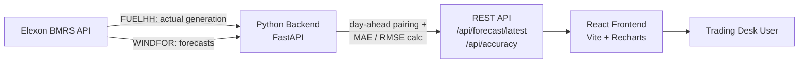

# Wind Power Procurement Dashboard

A web application that helps a UK energy utility's day-ahead trading desk decide how much extra power to buy from the wholesale market, by surfacing the latest **wind generation forecast** and **quantifying how accurate past forecasts have been** — using national-level data from [Elexon BMRS](https://bmrs.elexon.co.uk/).

**Live app:** https://zxq482.vercel.app
**API:** https://zxq482.onrender.com

---

## The Problem

The utility buys electricity from the day-ahead market to cover demand not met by its own renewable generation. Wind output is weather-dependent, so purchase decisions rely on **forecasts** made a day in advance. This tool answers two questions for the trading desk:

1. **What does the latest wind forecast say** about the next delivery period?
2. **How much should that forecast be trusted?** — quantified as Mean Absolute Error (MAE) and RMSE against what actually happened.

## Architecture



**Methodology — day-ahead pairing:** For every actual half-hour settlement period, the backend selects the forecast that was published on the **previous calendar day** — i.e. exactly what the desk would have had in hand when making its purchase decision — rather than using the most recent (same-day) forecast, which would overstate accuracy.

## Tech Stack

| Layer | Tech |
|---|---|
| Backend | Python, FastAPI, Uvicorn |
| Frontend | React (Vite), Recharts |
| Data source | Elexon BMRS Insights API (FUELHH, WINDFOR) |
| Containerization | Docker, Docker Compose |
| Deployment | Render (backend), Vercel (frontend) |

## Project Structure

```
gridbricks-challenge/
├── backend/
│   ├── main.py            # FastAPI routes
│   ├── elexon_client.py   # Elexon API calls
│   ├── analysis.py        # day-ahead pairing + MAE/RMSE
│   ├── requirements.txt
│   └── Dockerfile
├── frontend/
│   ├── src/
│   │   ├── App.jsx                  # layout
│   │   ├── ForecastChart.jsx        # latest forecast chart
│   │   ├── AccuracyOverlayChart.jsx # actual vs forecast overlay
│   │   ├── ErrorChart.jsx           # daily error chart
│   │   └── api.js                   # backend calls
│   ├── package.json
│   └── Dockerfile
└── docker-compose.yml
```

## API Endpoints

| Endpoint | Returns |
|---|---|
| `GET /api/forecast/latest` | Most recently published forecast run and every settlement period it covers |
| `GET /api/accuracy` | Day-ahead actual-vs-forecast pairs for January 2026, plus MAE/RMSE summary and daily error breakdown |

## Run locally

**With Docker (recommended):**
```bash
docker compose up --build
```
Frontend → `http://localhost:3000` · Backend → `http://localhost:8000`

**Without Docker:**
```bash
# backend
cd backend
pip install -r requirements.txt
uvicorn main:app --reload

# frontend (separate terminal)
cd frontend
npm install
npm run dev
```

## AI tools used

This project was built with assistance from **Claude (Anthropic)** for architecture design, backend/frontend code generation, debugging, and this README.

## Deployed links

- Frontend: https://zxq482.vercel.app
- Backend API: https://zxq482.onrender.com

> Note: the backend is on Render's free tier, which spins down after inactivity — the first request after idle time may take 30–50 seconds.